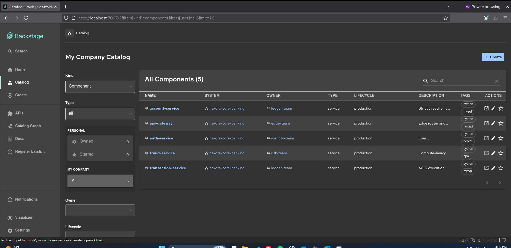
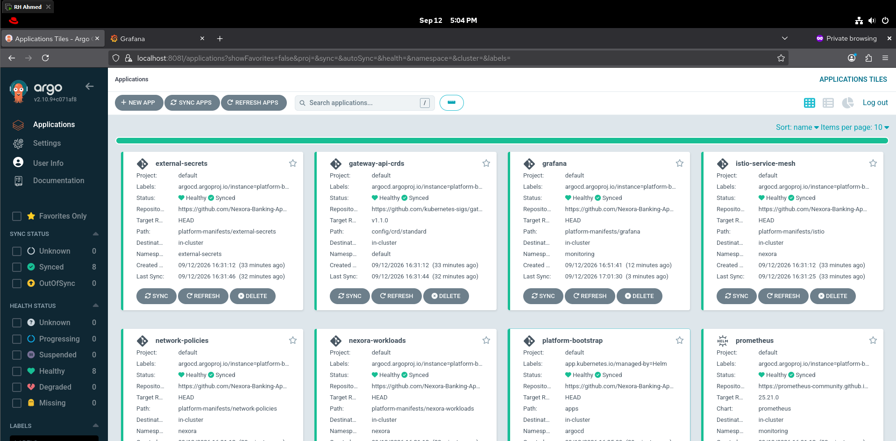

***

<div align="center">

# Nexora Core Banking: Platform Configuration (`platform-config`)

### GitOps Root, Service Mesh, Zero-Trust Policies, and Developer Experience

**ArgoCD • Istio Service Mesh • Kubernetes NetworkPolicies • Prometheus • Grafana • Backstage**

<br>


<br>

This repository is the **GitOps Root** for the Nexora Enterprise Platform. Following the declarative App-of-Apps pattern, a single root application injected during Terraform provisioning reconciles all platform controllers, security boundaries, and developer tools directly from this repository without manual operator intervention.

</div>

---

## Table of Contents

1. [Architectural Philosophy](#architectural-philosophy)
2. [Current Staging Deployment](#current-staging-deployment)
3. [Directory Structure](#directory-structure)
4. [The App-of-Apps Synchronization Model](#the-app-of-apps-synchronization-model)
5. [Platform Component Specifications](#platform-component-specifications)
6. [Operator Tooling & Local Access](#operator-tooling--local-access)
7. [Real-World Troubleshooting & Solutions](#real-world-troubleshooting--solutions)
8. [Known Gaps & Open Items](#known-gaps--open-items)

---

## Architectural Philosophy

In this platform, **the cluster is a runtime projection of Git**. 

Terraform installs the core Kubernetes operators (ArgoCD, Istio Base/Istiod, Argo Rollouts, AWS Load Balancer Controller) and injects the `platform-bootstrap` Root Application. From that moment forward, **`platform-config` assumes complete ownership of cluster state**.

Application workloads (`nexora-apps`) do not configure their own security policies, service meshes, or cluster-scoped namespaces; the platform layer declares these primitives centrally to enforce corporate compliance and zero-trust isolation.

### Current Staging Deployment

Verified **2026-10-06** on the `nexora-staging` EKS cluster in `us-east-1`:

| Component | Deployed configuration |
|---|---|
| EKS workers | Two `m7i-flex.large` nodes; Kubernetes `1.33` |
| Argo CD | `2.10.9`; annotation-plus-label resource tracking |
| Service mesh | Istio `1.22.0`; namespace-level `PeerAuthentication` is `PERMISSIVE` |
| Workloads | `nexora-workloads` points to the staging Kustomize overlay in `app-manifests` |
| Streaming | Strimzi `1.2.0`; Kafka `4.3.1`, three KRaft broker/controller replicas |
| Monitoring | Prometheus server and Alertmanager use persistent `ebs-gp3` claims (8 GiB and 2 GiB); see [Observability](#5-observability-prometheus-grafana-logging-tracing-runbooks) for rules, dashboards, logs and traces added after this verification |
| Secrets | External Secrets Operator reads AWS Secrets Manager through IRSA |

At verification, every Argo CD application was **Synced/Healthy**. Production
manifests exist in the repositories, but this status describes staging only.

---

## Directory Structure

```text
platform-config/
├── apps/                               <-- ArgoCD Application Manifests (Root App-of-Apps Targets)
│   ├── external-secrets.yaml            <-- ESO Helm chart & SecretStore
│   ├── gateway-api.yaml                 <-- Kubernetes Gateway API CRDs
│   ├── grafana.yaml                    <-- Grafana Helm deployment & datasources
│   ├── kafka.yaml                      <-- Kafka cluster (Sync Wave 3)
│   ├── istio.yaml                      <-- Istio mTLS policies
│   ├── network-policies.yaml           <-- Zero-Trust microsegmentation
│   ├── nexora-workloads.yaml            <-- Workload pointer (Sync Wave 5)
│   ├── prometheus.yaml                 <-- Persistent Prometheus monitoring stack
│   ├── storage.yaml                    <-- EBS StorageClass
│   ├── strimzi.yaml                    <-- Strimzi operator and CRDs (Sync Wave 1)
│   ├── logging.yaml                    <-- Loki + Fluent Bit
│   └── tracing.yaml                    <-- Tempo + OpenTelemetry Collector
│
├── apps-prod/                          <-- ArgoCD Applications for the PROD cluster (kube-prometheus-stack, grafana-operator, ...)
│
├── platform-manifests/                 <-- The Kustomize Blueprints & Configurations
│   ├── external-secrets/               <-- SecretStore & ESO CRD definitions
│   ├── grafana/                        <-- Grafana chart, datasources, ESO password binding, dashboards/ (JSON)
│   ├── istio/                          <-- PeerAuthentication mTLS rules
│   ├── kafka/                          <-- Strimzi Kafka, topics, users, and access policy
│   ├── logging/                        <-- Loki and Fluent Bit (Loki labels: namespace, pod, container, app)
│   ├── tracing/                        <-- Tempo and the OpenTelemetry Collector
│   ├── network-policies/               <-- Default-deny, per-service rules, Kafka, Prometheus scrape, OTLP egress
│   ├── nexora-workloads/               <-- Application-manifest pointer
│   ├── prometheus/                     <-- Helm values, alerts, and SMTP ExternalSecret
│   ├── storage/                        <-- EBS StorageClass
│   ├── strimzi/                        <-- Strimzi operator chart
│   └── backstage/                      <-- Spotify Backstage IDP Helm chart & RFC 6902 JSON patch
│
├── platform-manifests-prod/            <-- PROD-only manifests: kube-prometheus-stack, ServiceMonitor, PrometheusRule, Grafana CRs
│
├── runbooks/                           <-- One runbook per alert
│
├── .github/workflows/validate.yaml     <-- PR checks: kustomize build, promtool, amtool, runbook and dashboard checks
│
└── scripts/
    ├── open-dashboards.sh              <-- 1-Click operator dashboard launcher
    └── sync-prod-rules.py              <-- Generates the prod PrometheusRule from the staging rules
```

---

## The App-of-Apps Synchronization Model

Instead of managing individual applications manually, the platform uses an **App-of-Apps hierarchy** governed by ArgoCD Sync Waves:

```text
[ Terraform Root Application: platform-bootstrap ]
                        │
                        ▼ (Watches platform-config/apps/)
     ┌──────────────────┼──────────────────┬───────────────────┐
     ▼ (Wave 0)         ▼ (Wave 1)         ▼ (Wave 3)          ▼ (Wave 5)
[ platform basics ] [ Strimzi operator ] [ Kafka cluster ] [ nexora-workloads ]
(CRDs, ESO, mesh,                       (topics and users)  (banking services)
 network policies)
```

### Sync Wave Discipline: Eliminating Bootstrapping Races
To prevent workloads from attempting to mount secrets or attach to namespaces before platform controllers are healthy:
* **Wave 0:** Prerequisites including Gateway API CRDs, External Secrets, storage, network policies, and Istio.
* **Wave 1:** Strimzi operator and Kafka CRDs.
* **Wave 3:** Kafka cluster, topics, and users.
* **Wave 5:** `nexora-workloads`.

---

## Platform Component Specifications

### 1. Zero-Trust Network Policies (`/network-policies`)
Split into one file per concern (`default-deny.yaml`, `microservice-rules.yaml`, `policies.yaml` for the gateway, `kafka-client-rules.yaml`, `prometheus-scrape.yaml`, `tracing-egress.yaml`). NetworkPolicies are additive, so each file only adds access.
* **Namespace Ownership:** Centrally creates `Namespace/nexora` with the `istio-injection: enabled` label baked in.
* **Default-Deny:** Drops all ingress and egress network traffic across the namespace by default (only DNS port 53 is whitelisted).
* **Explicit Microsegmentation:**
  * `api-gateway`: Allowed ingress from Load Balancer; egress to `auth`, `account`, and `transaction` services.
  * `transaction-service`: Ingress from `api-gateway` and `auth-service`; egress to `fraud-service` and MySQL port 3306.
  * `fraud-service`: Ingress strictly from `transaction-service`. Egress strictly blocked.

### 2. Service Mesh mTLS (`/istio`)
* **PeerAuthentication:** Deploys `default-strict-mtls` in `mode: PERMISSIVE`. This allows the external Ingress Gateway to deliver public HTTP traffic while enforcing mutual TLS (mTLS) with automatic X.509 certificate rotation across all internal pod-to-pod financial traffic.

### 3. External Secrets Operator (`/external-secrets`)
* **ClusterSecretStore:** Binds to AWS Secrets Manager in `us-east-1` using the pod's IRSA ServiceAccount.
* **Zero Plaintext Secrets:** Completely eliminates static secrets in Git. Pulls database passwords, JWT encryption keys, and internal service secrets dynamically into Kubernetes memory.

### 4. Kafka (`/strimzi` & `/kafka`)
* Strimzi `1.2.0` manages a three-replica Kafka `4.3.1` KRaft cluster in the `kafka` namespace.
* Each combined broker/controller requests `100m` CPU and `1Gi` memory, and uses a 20 GiB `ebs-gp3` claim. Kafka uses internal TLS with SCRAM-SHA-512, three-way topic replication, and a minimum in-sync replica count of two.
* Kafka PVs currently use the `Retain` reclaim policy. Preserve and explicitly rebind retained volumes when recovering the cluster; do not assume a fresh cluster automatically adopts them.

### 5. Observability (`/prometheus`, `/grafana`, `/logging`, `/tracing`, `runbooks/`)

**Scrape configuration**
* Staging uses the plain `prometheus` chart. Pods are discovered through `prometheus.io/*` annotations (job `kubernetes-pods`); the pod label `app` becomes the `app` label on every series. With Istio sidecars the annotations are rewritten so Prometheus scrapes the merged endpoint on port 15020.
* `scrape_interval` and `evaluation_interval` are 30 seconds. Every rate window in rules and dashboards is at least `[2m]`.
* NetworkPolicy `allow-prometheus-scrape` lets the `monitoring` namespace reach all `nexora` pods on TCP 8000 and 15020.
* Prometheus keeps an 8 GiB persistent `ebs-gp3` volume (256 MiB requested, 2 GiB memory limit); Alertmanager keeps 2 GiB.

**Alert rules** (group `nexora-slo-and-health`, plus `HighFraudServiceCPU`)

| Alert | Fires when | Severity |
|---|---|---|
| `HighHTTP5xxRate` | a service returns > 10% 5xx for 5 min (health and metrics endpoints excluded) | critical |
| `TransferErrorBudgetFastBurn` | `/transfer` 5xx ratio > 1.44% over both 1 h and 5 min (99.9% SLO, burn rate 14.4) | critical |
| `NodeNotReady` | a node is not Ready for 5 min | critical |
| `HighHTTPLatencyP99` | a service's p99 latency > 1 s for 10 min | warning |
| `PodCrashLooping` | a container keeps restarting for 15 min | warning |
| `ContainerOOMKilled` | a container's last termination was an OOM kill | warning |
| `ContainerMemoryNearLimit` | an app container uses > 85% of its memory limit for 10 min | warning |
| `HPAAtMaxReplicas` | an HPA sits at max replicas for 15 min | warning |
| `TargetDown` | a scrape target is down for 5 min | warning |
| `PersistentVolumeFillingUp` | a PVC has < 15% free for 10 min | warning |
| `HighFraudServiceCPU` | a fraud-service pod uses > 80% of its CPU limit for 5 min | warning |
| `Watchdog` | always (proves the pipeline works) | none |

Recording rules `sli:transfer_errors:ratio_rate5m` and `sli:transfer_errors:ratio_rate1h` hold the transfer error ratio.

**Routing (Alertmanager)**
* Grouped by `alertname`, `namespace`, `app`; `group_wait` 30s, `group_interval` 5m, `repeat_interval` 4h.
* `severity="critical"` goes to email and repeats every 30 minutes. Warnings go to email on the 4-hour default.
* `Watchdog` goes to a `null` receiver.
* `NodeNotReady` mutes warning and critical alerts that carry the same `node` label.
* SMTP credentials are mounted from an ExternalSecret-backed Secret; no password is stored in Git.

**Runbooks:** one file per alert in [`runbooks/`](runbooks/) (meaning, impact, first three checks, mitigation, escalation). Each alert links to its runbook through the `runbook_url` annotation. CI fails if an alert has no runbook.

**Dashboards as code:** JSON files in `platform-manifests/grafana/dashboards/`, loaded by the Grafana sidecar from ConfigMaps labelled `grafana_dashboard=1` (folder "Nexora").
* *Nexora / Workloads (RED)*: request rate, 5xx %, latency percentiles per service, transfer outcomes, top handlers.
* *Nexora / CPU and memory*: usage against limits, throttling, restarts, OOM kills, fraud HPA, node usage.
* *Nexora / Logs*: log volume, error rate, HTTP status, and log panels including a `correlation_id` search.

Grafana datasources (fixed uids): `prometheus`, `alertmanager`, `loki`, `tempo`. The admin password comes from AWS Secrets Manager via ESO.

**Logs:** Fluent Bit sends container logs to Loki with four stream labels only: `namespace`, `pod`, `container`, `app`. Health-probe and metrics-scrape lines are dropped. The services write JSON, so everything else (`correlation_id`, `status`, `duration_ms`, `trace_id`) is queried with `| json`.

**Traces:** the services export OTLP to an OpenTelemetry Collector (`memory_limiter`, `k8sattributes`, tail sampling: every error, every trace slower than 1 s, 10% of the rest), which forwards to Tempo. Grafana links traces to logs through `trace_id`. NetworkPolicy `allow-otlp-egress` opens ports 4317/4318 to the collector.

**Production variant (`apps-prod/`, `platform-manifests-prod/`):** prod uses `kube-prometheus-stack` and `grafana-operator`, so its configuration is custom resources: a `ServiceMonitor` for the five services, a `PrometheusRule` generated from the staging rules by `scripts/sync-prod-rules.py` (CI checks they are in sync), and `Grafana`, `GrafanaDatasource` and `GrafanaDashboard` resources that reuse the same dashboard JSON. The prod set has been rendered and linted but not deployed.

**Remaining gaps**
* `Watchdog` has no external receiver, so nothing notices if the whole alerting pipeline dies.
* Canary weights are approximated by pod count (no Istio traffic routing for the rollout); the canary analysis measures the whole service, not the canary pods alone.
* Tracing is new and unverified on a live cluster. Prometheus exemplars are configured in Grafana but the services do not emit them yet.
* `HighHTTPLatencyP99` includes health probes, because the high-resolution histogram has no handler label.
* The chart values `pushgateway.enabled` and `nodeExporter.enabled` in the staging Prometheus kustomization are not keys this chart version reads (the real keys are `prometheus-pushgateway` and `prometheus-node-exporter`), so the Pushgateway is still deployed.

### 6. Developer Experience: Backstage IDP (`/backstage`)
* Deployed via the official Backstage Helm chart.
* **RFC 6902 JSON Patch:** Injects `APP_CONFIG_backend_auth_dangerouslyDisableDefaultAuthPolicy = true` and `APP_CONFIG_auth_environment = development` directly into the container spec, allowing unauthenticated Guest access for development demos.
* Imports the core banking catalog and visualizes inter-service dependencies.



---

## Operator Tooling & Local Access

In compliance with enterprise banking security, administrative control planes (ArgoCD, Grafana, Backstage) are **never exposed to the public internet**.

Platform engineers access internal tooling via cluster-authenticated port-forwarding (governed by AWS IAM Access Entries on the EKS cluster):

```bash
cd platform-config
./scripts/open-dashboards.sh
```

**Automated Launcher Output:**
* **Banking Application:** `http://<AWS_LOAD_BALANCER_URL>` (Public Ingress)
* **ArgoCD GitOps Dashboard:** `https://localhost:8081` *(User: admin)*
* **Grafana Observability Suite:** `http://localhost:3000` *(User: admin, Password pulled from AWS Secrets Manager)*
* **Backstage Developer Portal:** `http://localhost:7007` *(Guest Login)*



---

## Real-World Troubleshooting & Solutions

### 1. Backstage Node.js Crash on Array Environment Variables
* **Symptom:** The Backstage container entered `CrashLoopBackOff` with `TypeError: Invalid env config key 'catalog_locations_0_type'`.
* **Diagnosis:** Backstage’s `@backstage/config-loader` parses `APP_CONFIG_*` environment variables using underscores as delimiters, but explicitly forbids numeric array indices (like `_0_`).
* **Fix:** Removed array configurations from environment variables. Configured Backstage to use scalar auth bypass keys, and imported the catalog URL directly through the Backstage UI import pipeline.

### 2. Kustomize SecretGenerator Name-Hashing Collision with ESO
* **Symptom:** Grafana pod failed to start with `couldn't find key admin-password in Secret monitoring/grafana-admin-credentials-dthb4m5b7m`.
* **Diagnosis:** Kustomize’s `secretGenerator` appended a random content hash (`-dthb4m5b7m`) to the secret name. The Helm chart looked for the hashed name, but ESO was writing the password into the unhashed plain secret name.
* **Fix:** Added `generatorOptions: disableNameSuffixHash: true` to `platform-manifests/grafana/kustomization.yaml` to guarantee exact name alignment.

### 3. Prometheus Server OOMKilled at 57 Seconds
* **Symptom:** `prometheus-server` repeatedly entered `CrashLoopBackOff` (Exit Code 137) roughly one minute after boot.
* **Diagnosis:** Prometheus started with 256Mi memory. At 30 seconds, it began actively scraping metrics from the six services (plus sidecars), AWS CNI, and the EKS control plane. The metric buffer exceeded 256Mi, triggering a kernel OOMKill.
* **Fix:** Increased the memory limit to 2 GiB in `platform-manifests/prometheus/kustomization.yaml`, providing sufficient headroom for TSDB block indexing.

### 4. Database Init Job Connection Refused (Error 111)
* **Symptom:** `nexora-db-init-job` failed to connect to MySQL on AWS RDS with `ERROR 2003 (HY000): Can't connect to MySQL server (111)`.
* **Diagnosis:** Two compounding issues: (1) `default-deny-all` NetworkPolicy blocked all egress from the job pod. (2) Istio injected an unready Envoy sidecar into the one-off batch job, which reset the TCP connection.
* **Fix:** Added a dedicated egress NetworkPolicy rule for the job pod, and added the `sidecar.istio.io/inject: "false"` annotation to the job template to bypass Istio iptables interception entirely.

---

## Known Gaps & Open Items

* **Istio Ingress mTLS Permissive Mode:** `PeerAuthentication` is configured with `mode: PERMISSIVE` rather than `STRICT` at the namespace root to accommodate plain HTTP traffic forwarded by the Ingress Load Balancer. In a strict zero-trust audit, mTLS should be terminated at the Gateway pod, and a `DestinationRule` should enforce strict mTLS for all subsequent internal hops.
* **Backstage Development Auth Bypass:** `dangerouslyDisableDefaultAuthPolicy: true` is enabled via Kustomize patch to allow unauthenticated guest evaluation for demonstration purposes. In a true production deployment, this bypass is removed, and Backstage must be integrated with an enterprise identity provider (e.g., GitHub OAuth, Okta, or Keycloak).